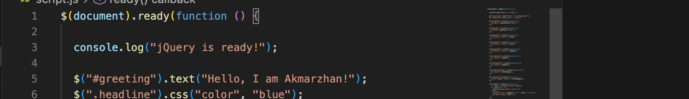
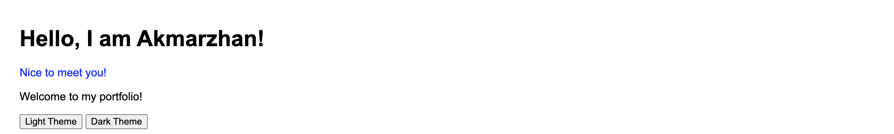
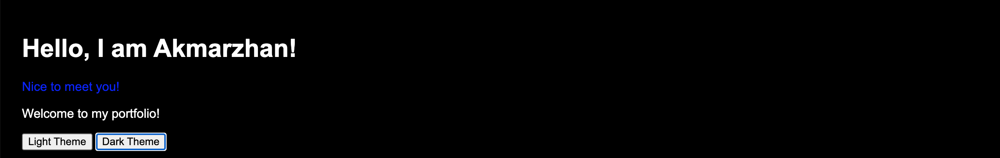
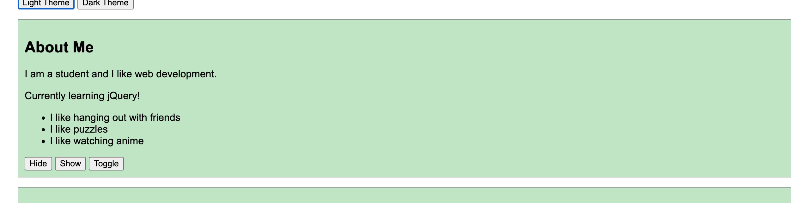
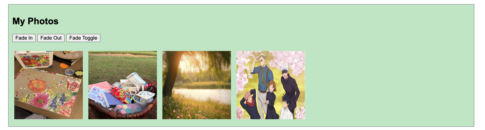
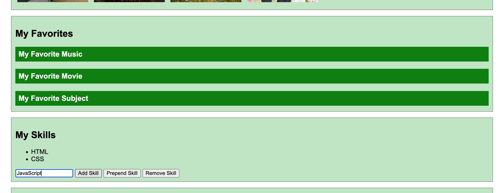
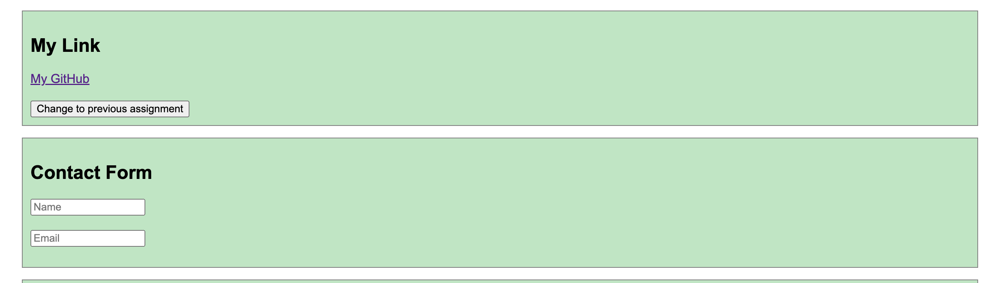
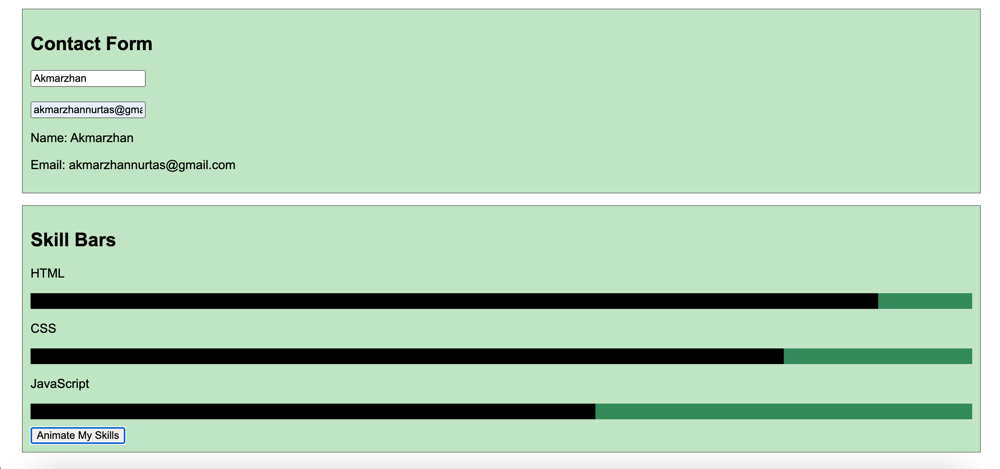

# Assignment 6 - jQuery Portfolio

**Name:** Akmarzhan Nurtas
**Group:** SE-2538

## Task 0 - Setup
Added jQuery from CDN and printed "jQuery is ready!" in the console.

## Task 1 - Selectors & CSS
Changed greeting with .text() and changed color with .css(). Added light and dark theme buttons.

## Task 2 - Visibility
Hide / Show / Toggle buttons for the status message and fun facts.

## Task 3 - Fade
Fade In / Fade Out / Fade Toggle for photos.

## Task 4 - Slide and Add & Remove
Three clickable headings open panels with slideToggle.
Skill list with Add, Prepend, and Remove buttons. Empty skill shows an alert.

## Task 5 - Attributes
Button changes the link with .attr().

## Task 6 - Form and Animation
Name and Email are shown live with .val() and .text().
Skill bars grow with .animate() and go back to zero on second click.

## Summary
I built the HTML first, then added CSS, then wrote the jQuery code for each task.
I tested every button in the browser and took screenshots.
Finally I uploaded everything to GitHub and turned on GitHub Pages.
